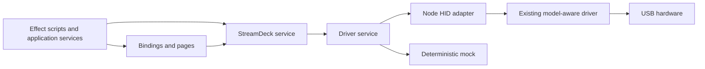

# Stream Deck scripting with Effect v4

Research and implementation: 13 October 2026. Target: the USB Stream Deck + XL
already tested on this machine, plus other models described by the driver.

## Existing libraries and useful ideas

| Source | What it provides | What we use or take inspiration from |
| --- | --- | --- |
| [Julusian/node-elgato-stream-deck](https://github.com/Julusian/node-elgato-stream-deck) | Community TypeScript packages for Node USB HID, WebHID and TCP, sharing a model-aware core. Independent of Elgato's desktop software. | Keep the tested Node 7.8.0 driver: model discovery, typed control definitions, image encoding/orientation, buttons, dials, LCD and region drawing. Wrap its native boundary once. |
| [python-elgato-streamdeck](https://github.com/abcminiuser/python-elgato-streamdeck) and [base device API](https://github.com/abcminiuser/python-elgato-streamdeck/blob/master/src/StreamDeck/Devices/StreamDeck.py) | Device enumeration, brightness, image helpers, button state, dial and touchscreen callbacks including asyncio adapters. Supports the + XL. | Separate capabilities from behavior; expose all input families; keep convenient image helpers near the scripting API. |
| [OpenActionAPI/rust-elgato-streamdeck](https://github.com/OpenActionAPI/rust-elgato-streamdeck) | A HID-backed hardware library with device discovery, model-specific image conversion and input events. Its README lists + XL support. | A small hardware abstraction is sufficient; avoid rebuilding a full plugin application to run a few scripts. No Rust code copied. |
| [Bitfocus Companion](https://github.com/bitfocus/companion) and [feedback model](https://github.com/bitfocus/companion/wiki/Feedback) | A mature control application separating actions from feedback, with many integrations. | Treat a profile as handlers plus initial visual feedback; keep page selection explicit and application actions in scripts. No Companion code copied. |
| [Elgato plugin SDK](https://docs.elgato.com/sdk) | Plugins and action lifecycles inside the official Stream Deck application. | Useful conceptual vocabulary, but it requires the desktop application and is not our Linux USB backend. |

The libraries largely agree on the useful hardware features: discover/open/close,
capabilities and identity, images/colors, brightness, button edges, dial edges
and signed ticks, LCD updates and touch gestures. Higher-level applications add
actions, state-driven feedback and pages. Our library implements that smaller
hardware/scripting boundary; application integrations remain ordinary Effects.

## Official HID documentation

Elgato now documents [the HID protocol](https://docs.elgato.com/streamdeck/hid/general/)
and the [Stream Deck + XL](https://docs.elgato.com/streamdeck/hid/stream-deck-plus-xl/).
The latter confirms VID:PID `0fd9:00c6`, 36 buttons, six encoders, 112×112 key
images and a 1200×100 touch window. This agrees with the physical PoC.

The + XL's image transfers require model-specific orientation and packetization.
These belong to the existing driver, rather than to our scripts. Public image
coordinates stay logical and unrotated. The touch window reports completed
gestures, not independent touch-down/touch-up edges: use a physical button's
press/release pair for behaviors that need those edges.

## Effect version and architecture

The npm registry's stable `latest` tag resolved to **effect 4.0.4** and matching
**@effect/platform-node 4.0.4** on the research date. Both are exactly pinned.
The implementation was checked against installed declarations and the official
[v4 documentation](https://effect.website/docs/v4/onboarding),
[services](https://effect.website/docs/v4/requirements-management/services),
[PubSub](https://effect.website/docs/v4/concurrency/pubsub) and
[semaphores](https://effect.website/docs/v4/concurrency/semaphore).

- `Context.Service` describes dependencies. `Layer.effect` constructs one scoped
  device; v4 does not need the old `Layer.scoped` constructor.
- `Effect.acquireRelease` owns the native handle and listener lifetime.
  `NodeRuntime.runMain` owns process signals; library code never installs global
  SIGINT handlers or calls `runPromise` internally.
- [Effect CLI](https://effect.website/docs/v4/api/effect/cli/Command) owns command
  definitions, flag parsing, help and validation through `Command`, `Flag` and
  `Schema`. `NodeServices.layer` provides its platform dependencies. No custom
  parser, Node `parseArgs`, direct argv access or manually rendered help remains.
- A bounded `PubSub` broadcasts normalized events. Subscriptions are independent,
  live and scoped. There is no event replay that could trigger an old action.
- A `Deferred` retains terminal errors, including errors before subscriptions.
  Callback overflow fails explicitly; it does not silently discard a release.
- One `Semaphore` serializes native calls. An in-flight native promise retains
  its permit until completion even if the calling fiber is interrupted. Cleanup
  happens after scoped children terminate. Pixels are copied before queuing.
- `Bindings` validates indices and zones, subscribes before drawing feedback,
  and routes handlers sequentially. A handler's typed failure fails the runner;
  scripts choose recovery with normal Effect operators. Terminal device errors
  race the runner, so even a suspended handler is interrupted on disconnect.
- `Bindings.pages` owns only keys named by its pages, clears stale feedback, and
  routes release back to the profile that received the matching press.
- Script state belongs in `Ref`, services, schedules and scoped fibers. There is
  no custom action class hierarchy, plugin registry or parallel promise runtime.

## Features implemented

Discovery and explicit multi-device selection; actual USB IDs; key and LCD RGB
images, solid colors and labels; bounded simulated gauges; LCD region updates;
explicit brightness/logo commands; firmware/serial queries; normalized key/dial
edges, signed dial deltas, tap/hold/swipe; touch zones; profiles/pages; deterministic
mock and finite CLI demos. Hardware imports are lazy, so mock mode works without
libudev or a connected device.

Labels use a tiny uppercase bitmap alphabet with digits. `setImage` accepts raw
RGB pixels, not compressed PNG/JPEG file bytes. A file decoder or richer renderer
can return the same `RgbImage`; it does not need to know HID framing. Arbitrary
image resizing, SVG/font rendering and an asset cache are not implemented.

## Deliberate limits and composition

- One device per owning layer. A second open of the same path in this process
  is rejected; reuse the device layer. This cannot detect another HID application.
- No automatic reconnect: failures close the program's scope. Rediscover first;
  a script can wrap the complete scoped program in an intentional retry policy.
- Handlers run in input order. Keep them short. For long independent work,
  explicitly use `Effect.forkScoped` and handle that child's errors. Use Effect
  schedules/streams for animation or external state updates. Buffer capacity
  defaults to 256 and can be configured, but increasing it is not a cure for an
  indefinitely blocked handler.
- If a third-party native promise never settles, draining it can delay shutdown.
  An arbitrary timeout cannot safely cancel that HID operation. This limit is
  distinct from the tested normal interruption/disconnection paths.
- Pages route queued input when consumed. Script-driven context switching is
  explicit; there is no active-window watcher or daemon in this package.
- Page render effects and handlers may require any Effect services. Provide those
  layers alongside the device layer; focus, Discord, PipeWire and OBS adapters
  do not belong inside the hardware service.

The three editable scripts demonstrate the intended progression: `hello.ts`
reproduces the physical PoC; `playground.ts` assigns buttons, a knob and touch
zones; `pages.ts` switches profiles. These examples change only test displays
and log actions. No microphone, recording, audio or window-management action is
performed by default.
