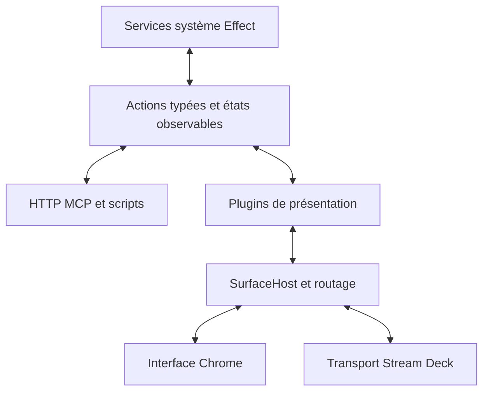

# Plan des services système et de la présentation Stream Deck

Date : 14 octobre 2026.

Ce plan fixe la direction du projet : une bibliothèque Effect de contrôle du
système, utilisable depuis des scripts, HTTP, MCP et une UI ; une bibliothèque
Stream Deck qui lui associe des gestes et des présentations. Les plugins exportent
des actions de présentation, des tiles et des scènes. Un dossier devient un plugin
de navigation capable de remplacer une zone de touches ou tout le deck.

Les orientations ci-dessous sont retenues pour la migration. Les noms d'API et
le découpage précis des fichiers sont des propositions à valider en implémentant
les premiers cas. La première étape est implémentée dans `packages/system-control` ;
voir [la livraison et ses preuves](system-control-implementation.md).
Les étapes suivantes sont livrées par incréments, dont les surfaces LCD configurables ;
la progression et les limites sont précisées dans ce même suivi.

## État de départ

Le point de départ est le commit `6df85fa`, dans le checkout isolé
`task-11/nixfiles-streamdeck`, branche `feat/streamdeck-usb-hello`.

- Effect v4, services et Layers, entrées avec gestes partagés et actions typées.
- Spotify/Spotifast via MPRIS, Discord, OBS, audio et commandes desktop existent.
- Les services et leur surveillance sont encore assemblés dans les plugins.
- `MixerCards` permet déjà à Spotify de contribuer sa vue, son comportement
  tactile, son agrandissement et son overlay de volume.
- Le mixer possède encore le LCD, sa disposition et ses potards.
- Les dossiers, zones et pages vivent encore dans le moteur de raccourcis.
- Studio fonctionne sans USB. `DeckConnection` gère le lifecycle matériel et
  `DeckOffline` ; la frontière de sortie Studio conserve le canvas et restaure
  le rendu à la reconnexion.
- Les touches web utilisent les mêmes gestes que le moteur : simple appui,
  double appui et appui long. Crayon ou clic droit pour éditer ; déplacement
  par le numéro, avec événements pointeur.

La dernière vérification couvre 158 tests Stream Deck et 22 tests veille, avec
lint, format et typecheck au vert. Elle valide cet état de départ, pas encore
l'architecture cible.

## Architecture cible

La bibliothèque système possède les intégrations et leurs ressources. Les plugins
possèdent leurs interactions et leurs vues. Le host possède la composition,
la disposition effective et le routage vers le bon propriétaire. Le transport
matériel possède les opérations HID et la connexion.

### Services système

Créer un package `packages/system-control`, indépendant de React, de Studio et
du Stream Deck. Ses modèles ne référencent ni touche, ni potard, ni tile, ni LCD.

| Service      | Responsabilités                                                               |
| ------------ | ----------------------------------------------------------------------------- |
| Audio        | Applications audio, sorties, volume, mute, limites disponibles et événements. |
| MediaPlayers | Découverte MPRIS, lecteurs, lecture, métadonnées, progression et capacités.   |
| Spotify      | Sélection et particularités Spotify/Spotifast au-dessus des lecteurs.         |
| Discord      | Connexion autorisée, état et opérations disponibles de Discord.               |
| OBS          | Connexion, état, scènes et opérations de capture/enregistrement.              |
| Desktop      | Applications, fenêtres et commandes système déclarées.                        |
| Voice        | Sessions de capture et communication avec la cible vocale.                    |

Chaque service expose des opérations Effect typées, un état courant, un flux de
changements et des erreurs métier. Les schémas et identifiants système stables
appartiennent à ce package. L'association entre un lecteur MPRIS et une application
audio doit être explicite ; un index de tile ou de potard ne sert pas d'identité
d'application.

Le Layer initialise lui-même les ressources, démarre les fibres scoped et les
termine à la fermeture du scope. Un consommateur obtient le service et utilise
son API sans devoir démarrer un `monitor` ou un `plugin.run` supplémentaire.

Les transports Linux actuels et les Layers de test restent interchangeables.
L'extraction réutilise les adaptateurs existants et leurs tests avant d'ajouter
d'autres plateformes.

### Runtime partagé et lifecycle

Un runtime système local héberge les intégrations utilisées par les différentes
interfaces. Chrome, les plugins Stream Deck et les adaptateurs HTTP/MCP consomment
les mêmes instances et le même état.

Une construction partagée des Layers évite de démarrer plusieurs connexions ou
boucles de surveillance pour une même intégration. La mémoïsation des Layers
ne constitue pas un singleton entre processus : un adaptateur MCP stdio dans
un autre processus se connectera au runtime local.

Le scope du runtime détient les services partagés. Les scopes consommateurs
détiennent leurs abonnements, mappings et présentations. Désactiver un plugin
de présentation libère ses ressources sans fermer un service encore utilisé par
une autre interface. L'activation d'une intégration système et l'activation de sa
présentation sont deux réglages distincts.

Les ressources créées pour une action durable ont un scope de session : capture
microphone, enregistrement ou autre opération à maintenir. L'interface reçoit
un handle de terminaison/annulation. Relâchement, arrêt explicite, expiration
de session et shutdown convergent vers le même nettoyage. Une requête HTTP
terminée ne devient pas implicitement la durée de vie d'une telle session.

Les services distinguent indisponibilité temporaire, configuration manquante,
capacité non supportée et échec d'opération. Une intégration indisponible expose
son état et ses erreurs sans arrêter les autres services. La reconnexion appartient
au service ; une configuration à corriger ne déclenche pas une boucle OAuth.

### Actions partagées

Déclarer explicitement les actions exposées, avec identifiant stable, description
et schémas d'entrée, de résultat et d'erreur. Leur exécution dépend des services
Effect. Les règles métier et la validation sont communes aux scripts, à HTTP,
à MCP et aux mappings de présentation.

Prévoir des opérations explicites telles que `setMuted(true)` en plus des toggles,
afin qu'un client puisse demander un état précis. Les séquences de lecture puis
modification concurrentes sont sérialisées dans le service concerné.

Le catalogue comporte deux familles d'actions :

- **Actions système** : lecture, volume, mute Discord, opération OBS…
- **Actions de présentation** : ouvrir un dossier, revenir, changer une page,
  présenter une scène… Elles dépendent du host de présentation.

Les descriptions système restent sans icône ou rendu propres au deck. Les
plugins associent une action à un feedback, une tile ou un geste. Les réglages
persistés référencent les identifiants d'actions et leurs paramètres validés.

## Surfaces et composition

`SurfaceHost` est le nom provisoire du service Effect de composition. Il gère
plusieurs surfaces logiques : la grille de touches et le LCD. Leurs capacités
et dimensions proviennent du modèle de deck ou du profil virtuel configuré.

Prendre toute la **grille de touches** et prendre tout le **LCD** sont deux cibles
distinctes. Une présentation peut demander une région de l'une, l'autre, ou les
deux explicitement. Les opérations impliquant plusieurs régions sont validées
et appliquées ensemble.

Le host est le seul chemin d'écriture matérielle pour les surfaces qu'il compose.
Les plugins soumettent leurs vues ; le host les compose, puis les envoie au
transport et à l'aperçu Chrome. Le mixer devient une scène cliente du host.

| Contribution | Contenu et rôle                                                                     |
| ------------ | ----------------------------------------------------------------------------------- |
| Tile         | Vue et interactions d'un élément : bouton, carte audio, piste en cours, dossier…    |
| Scene        | Disposition et interactions pour une surface ou une région.                         |
| Overlay      | Présentation temporaire au-dessus d'une scène : volume, notification, confirmation… |
| Presentation | Handle scoped d'une scène ou d'un overlay présenté, avec fermeture/annulation.      |

Une contribution déclare un identifiant stable, ses données, son rendu React,
ses contraintes de taille et ses interactions. Les paramètres nécessaires à son
instanciation sont validables et persistables ; les composants React et Effects
restent dans le code du plugin.

### Disposition et arbitrage

Une scène de base définit la disposition habituelle. Les présentations de premier
plan forment une pile par région ciblée ; la dernière demande de premier plan
devient visible dans la région concernée. Les overlays ont une couche distincte
et une politique d'interception explicite.

Fermer une présentation retire uniquement son propre handle. Fermer une entrée
masquée ne ferme pas une présentation ouverte ensuite par un autre plugin. Les
régions disjointes restent indépendantes. Des régions qui se chevauchent utilisent
la même règle de premier plan et un ordre déterministe.

Chaque région visible a une disposition résolue commune au rendu et au routage.
Le host valide les limites, les réservations et les contraintes avant activation.
Une demande impossible produit une erreur métier que l'éditeur peut expliquer.

Les tiles annoncent une taille minimale, une taille préférée et une possibilité
d'agrandissement. La scène alloue l'espace disponible. Dans la scène mixer,
Master est épinglé et les cartes d'applications se compactent et se paginent.
Une scène couvrant tout le LCD peut définir une autre disposition.

### Rendu et événements

Les vues pures React sont réutilisables par le renderer d'images du deck et par
le navigateur. Le host borne la cadence de rendu et regroupe les mises à jour
d'état remplaçables. Les commandes et gestes conservent leur ordre et ne sont
pas supprimés comme des frames intermédiaires.

Une présentation masquée conserve son état de navigation tant que son propriétaire
reste actif. Ses rendus peuvent être suspendus ; les services système continuent
selon leur propre lifecycle. Une génération de présentation empêche un ancien
rendu asynchrone de repeindre une vue retirée.

La lib de gestes conserve la responsabilité du simple appui, de l'appui court,
de l'appui long, du double appui, du release et du cancel. Le host associe ces
gestes aux contributions visibles et aux actions partagées. Les plugins ne
réimplémentent pas ces temporisations.

Chaque présentation précise les touches, potards et régions tactiles qu'elle
intercepte et ceux qu'elle laisse passer. Un overlay purement visuel peut laisser
passer les entrées. Une scène interactive de premier plan reçoit les contrôles
qu'elle déclare ; les contrôles couverts sans comportement ne déclenchent pas
implicitement une action masquée.

Le propriétaire d'un appui reste responsable de son release/cancel, même après
navigation. Une révision de disposition protège les événements web arrivant
après un changement de mapping. La désactivation du propriétaire annule ses
gestes et actions en cours. La déconnexion physique annule les appuis matériels
en conservant les entrées web indépendantes.

## Dossiers et pagination comme plugins

Le plugin Navigation exporte les actions ouvrir un dossier, revenir et paginer,
ainsi que les tiles correspondantes. Le contenu d'un dossier peut contenir
n'importe quel raccourci ou autre dossier : actions système, commandes,
présentations et widgets.

Le host fournit les mécanismes de région, de présentation et de routage. Le plugin
possède le comportement des dossiers, la pile de navigation et la tile Retour.

L'ouverture d'un dossier choisit une cible configurable :

- Un ensemble explicite de touches ou une zone existante.
- Un rectangle, par exemple 3 × 3 autour d'une touche d'ancrage.
- Toute la grille de touches.
- Une région ou toute la surface LCD pour une présentation compatible.

Une cible 3 × 3 désigne neuf touches physiques de la grille. L'ancrage et la position
du rectangle sont explicites. Près d'un bord, l'éditeur montre la zone réellement
demandée et valide ses limites ; il ne masque pas silencieusement d'autres
contrôles pour obtenir neuf places.

Le dossier présente son contenu dans cette région et y réserve une place pour
Retour selon sa configuration. Les touches hors de la région continuent leur
comportement. Les réservations conservées dans une région réduisent sa capacité
utile ; l'éditeur affiche combien de raccourcis pourront être visibles.

Retour ferme la présentation concernée et restaure la région précédente. Les
dossiers imbriqués suivent la même règle. La pagination modifie le contenu de sa
région sans déplacer les commandes de pagination ou réservations configurées.
La pagination du mixer LCD est une action distincte ciblant cette scène.

L'éditeur permet de choisir la cible, voir son emprise sur le deck, régler les
réservations et placer Retour/pagination. Une réservation locale peut être
couverte seulement lorsque la nouvelle présentation le demande explicitement
et que le host l'autorise. Les conflits restent visibles avant enregistrement.

## Spotify comme premier cas complet

Le service Spotify fournit lecture, état, progression et métadonnées. Son
adaptateur de présentation exporte une tile et une scène de lecteur.

La tile possède le mode volume/piste, le comportement tactile, la jaquette et
l'overlay circulaire de volume. Elle déclare ses besoins d'agrandissement ; la
scène mixer lui attribue l'espace disponible et conserve son ordre de placement.

Un geste configuré peut ouvrir la scène Spotify sur tout le LCD. Cette scène
déclare ses interactions tactiles et ses mappings de potards. Fermer sa
présentation restaure le mixer et les modes de ses cartes. Désactiver la
présentation Spotify retire ses tiles et scènes ; le service peut continuer à
servir le MCP ou un script.

Ce cas valide la frontière entre service, tile, scène, overlay, layout et routage
avant la généralisation aux autres intégrations.

## Migration progressive

| Étape                      | Travail                                                                                                                                                                                    | Preuve attendue                                                                                                                               |
| -------------------------- | ------------------------------------------------------------------------------------------------------------------------------------------------------------------------------------------ | --------------------------------------------------------------------------------------------------------------------------------------------- |
| 1. Extraire les services   | Déplacer Audio, MPRIS/Spotify et Discord vers `system-control`. Faire démarrer leur surveillance dans leurs Layers. Adapter les plugins existants.                                         | Les mêmes opérations et états sont accessibles depuis un script sans import du deck ; le comportement réel actuel reste fonctionnel.          |
| 2. Partager les actions    | Déclarer les schémas d'entrée, de résultat et d'erreur. Séparer catalogue système et actions de présentation. Réutiliser les formulaires existants.                                        | Une action est exécutée par plusieurs interfaces sans recopier sa logique ni sa validation.                                                   |
| 3. Introduire les surfaces | Ajouter `SurfaceHost`, régions, handles de présentation et routage. Migrer grille de raccourcis et mixer comme scènes de base. Faire évoluer `MixerCards` vers des contributions de tiles. | Une scène temporaire couvre une région ou tout le LCD, puis restaure la disposition précédente ; rendu et entrées restent cohérents.          |
| 4. Extraire Navigation     | Transformer dossiers, Retour et pagination en plugin de présentation. Exposer le choix des régions dans l'éditeur.                                                                         | Un dossier 3 × 3 ne change que les neuf touches choisies ; imbrication, Retour, réservations et pagination fonctionnent aussi en plein écran. |
| 5. Migrer Spotify          | Rassembler tile piste/volume, agrandissement, overlay et scène plein écran dans l'adaptateur Spotify.                                                                                      | Les comportements actuels sont conservés et le plein écran rend correctement la main au mixer.                                                |
| 6. Exposer le runtime      | Brancher HTTP et MCP sur les services et actions partagés. Extraire OBS, Desktop et Voice selon les mêmes contrats.                                                                        | Le MCP lit l'état et utilise les actions système sans deck ; les interfaces partagent leur état et les sessions se nettoient correctement.    |

Chaque étape conserve une application utilisable. Les premières abstractions
sont validées par ces cas concrets avant d'ajouter une DSL ou des mécanismes
d'extension supplémentaires.

## Compatibilité et vérification

Conserver les identifiants des raccourcis, les paramètres, les triggers et les
préférences d'activation. Migrer les profils existants de manière versionnée,
atomique et réversible. Les références à des actions indisponibles restent
visibles et réparables. Une configuration invalide n'est pas remplacée par un
profil vide.

Les vérifications de migration doivent couvrir :

- Acquisition et libération des ressources, reconnexion, erreurs typées,
  surveillance unique et coexistence de plusieurs consommateurs.
- Actions concurrentes, abonnement à l'état courant et aux changements, sessions
  longues avec release, annulation et expiration.
- Présentations superposées ou disjointes, fermeture dans un ordre différent de
  l'ouverture, désactivation d'un plugin et résultats de rendu retardés.
- Cohérence entre géométrie affichée, tile cible et propriétaire des entrées,
  notamment après compaction, pagination, agrandissement ou changement de scène.
- Dossiers partiels, bords de grille, capacité après réservations, imbrication,
  Retour et préservation des raccourcis extérieurs à la région.
- Gestes web et matériels, conflits entre propriétaires, événements périmés et
  fonctionnement sans USB avec restauration à la reconnexion.
- Les usages actuels : vrai mixer audio, Master épinglé dans sa scène, Spotify /
  Spotifast, Discord, commandes, édition et réarrangement des touches.

Les tests système utilisent des transports de test. Les tests de composition
utilisent un deck virtuel. Les essais d'enregistrement et de microphone se font
avec des doubles de test, puis avec un essai réel explicitement demandé.

Conserver les standards du projet : Effect v4 et I/O via ses services platform,
Oxlint/Oxfmt/Vitest, JSX en `.tsx`, imports explicites `.ts`/`.tsx`, `noEmit`,
`node --import tsx` et watch en développement, sans barrel ni script de build
Stream Deck. L'intégration veille garde son packaging et son runner propres.

## Points à préciser pendant les premiers cas

Les orientations sont fixées ; les premiers prototypes préciseront les formes
d'API de déclaration, les paramètres d'ancrage et de réservation, la politique
de suspension des scènes masquées et le transport local de l'adaptateur MCP.

Les invariants restent communs à ces choix : services indépendants des interfaces,
ressources scoped, contributions de présentation révocables, composition
déterministe et routage conforme à la disposition affichée.
